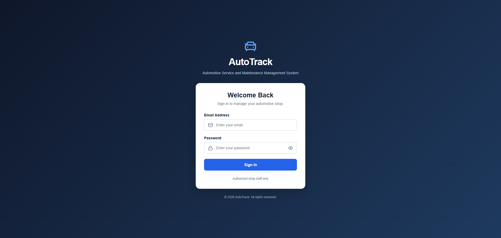
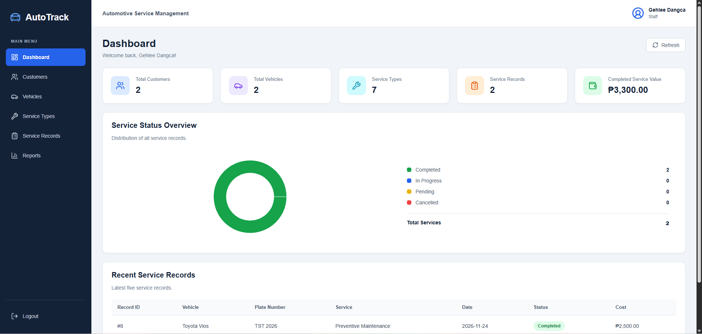
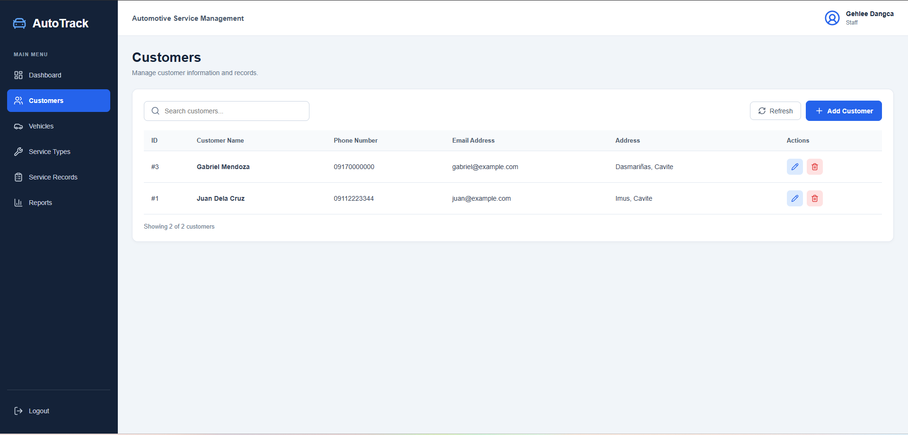
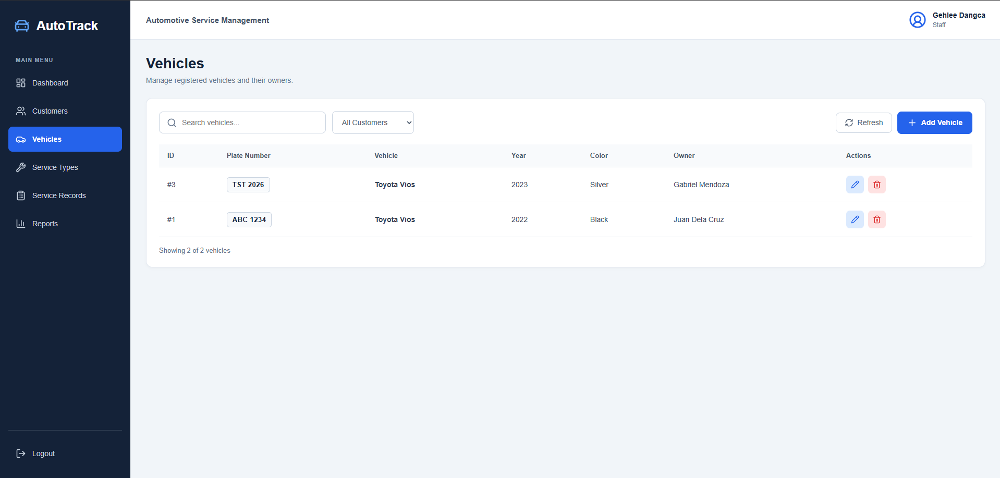
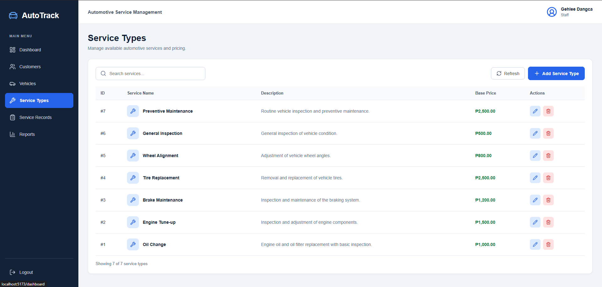
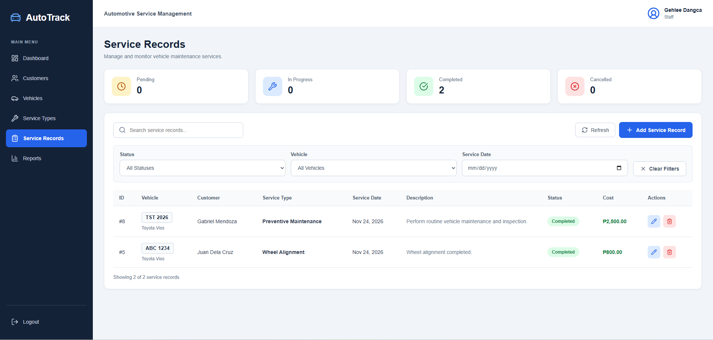
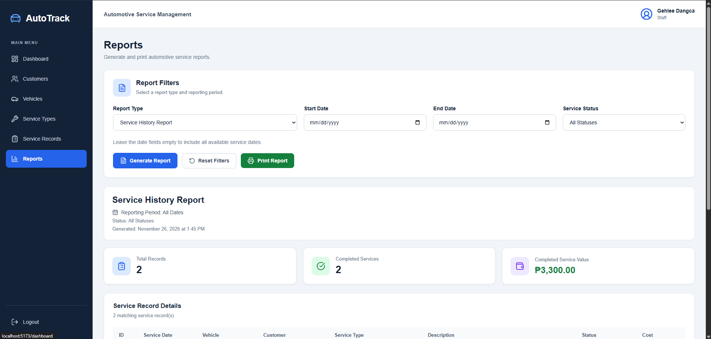

# AutoTrack

## Automotive Service and Maintenance Management System

AutoTrack is a web-based automotive service and maintenance management system designed to help automotive shops manage customer information, registered vehicles, available services, maintenance transactions, and service reports.

The system provides a RESTful backend API using NestJS, TypeORM, and MariaDB, with a React-based frontend that allows authorized shop staff to manage daily operations through a centralized interface.

Developed as a final project for ITEC 116 – Systems Integration.

---

## Project Objectives

- Centralize customer and vehicle information.
- Simplify automotive service and maintenance record management.
- Maintain accurate and organized service transactions.
- Provide secure access through JWT authentication.
- Generate service reports and completed service value summaries.
- Demonstrate RESTful API development and system integration.

## System Features

### Authentication and Security

- Staff account authentication
- JWT-based authorization
- Bcrypt password hashing
- Protected API endpoints
- Protected frontend routes
- Input validation
- Login and logout functionality

### Dashboard

- Total registered customers
- Total registered vehicles
- Total available service types
- Total service records
- Total completed service value
- Service status distribution
- Recent maintenance transactions

### Customer Management

- Register customers
- View customer information
- Search customer records
- Update customer information
- Delete customers without registered vehicles

### Vehicle Management

- Register customer vehicles
- Associate vehicles with their owners
- Search and filter vehicle records
- Update vehicle information
- Prevent duplicate plate numbers
- Prevent deletion of vehicles with service records

### Service Type Management

- Create automotive service types
- Define service descriptions
- Set base service prices
- Update service information
- Prevent duplicate service names
- Prevent deletion of referenced service types

### Service Record Management

- Create automotive maintenance transactions
- Associate vehicles with service types
- Record service dates and descriptions
- Manage service costs
- Track service status
- Update and delete service records

Supported service statuses:

- Pending
- In Progress
- Completed
- Cancelled

### Reports

- Service records report
- Completed service value report
- Date range filtering
- Service status filtering
- Printable reports
- Save reports as PDF using browser printing

## Technology Stack

| Component | Technology |
|-----------|------------|
| Backend Framework | NestJS |
| Programming Language | TypeScript |
| Object-Relational Mapping | TypeORM |
| Database | MySQL-compatible |
| Database Environment | XAMPP |
| Database Administration | phpMyAdmin |
| Authentication | JSON Web Token (JWT) |
| Password Hashing | Bcrypt |
| Input Validation | class-validator |
| Frontend Framework | React |
| Frontend Build Tool | Vite |
| HTTP Client | Axios |
| Routing | React Router |
| Icons | Lucide React |
| Data Visualization | Recharts |
| API Testing | Postman |
| Version Control | Git |
| Repository Hosting | GitHub |

## System Architecture

AutoTrack follows a client-server architecture.

    React Frontend
          |
          | HTTP / REST API
          v
    NestJS Backend
          |
          v
    Controllers
          |
          v
    Services
          |
          v
    TypeORM Repositories
          |
          v
    MySQL Database

The frontend communicates with the backend through RESTful API requests. NestJS controllers handle incoming requests, services implement business logic, and TypeORM repositories manage database operations.

JWT authentication guards protect restricted API endpoints, while DTOs validate incoming request data.

## Database Design

The system uses five main database tables:

| Table | Description |
|-------|-------------|
| users | Staff account information |
| customers | Customer personal and contact information |
| vehicles | Registered customer vehicles |
| service_types | Available automotive services |
| service_records | Automotive maintenance transactions |

### Database Relationships

- One customer can own multiple vehicles.
- One vehicle can have multiple service records.
- One service type can be associated with multiple service records.
- One staff account can create multiple service records.

Primary keys and foreign keys maintain data integrity between related tables.

## Project Structure

    AutoTrack/
    ├── database/
    │   └── autotrack_database.sql
    ├── frontend/
    │   ├── public/
    │   ├── src/
    │   │   ├── api/
    │   │   ├── components/
    │   │   ├── layouts/
    │   │   ├── pages/
    │   │   └── styles/
    │   ├── index.html
    │   └── package.json
    ├── src/
    │   ├── auth/
    │   ├── users/
    │   ├── customers/
    │   ├── vehicles/
    │   ├── service-types/
    │   ├── service-records/
    │   ├── reports/
    │   ├── app.module.ts
    │   └── main.ts
    ├── .env.example
    ├── .gitignore
    ├── package.json
    ├── package-lock.json
    └── README.md

## Installation Requirements

Before installing the project, ensure that the following software is installed:

- Node.js and npm
- XAMPP
- Git
- Visual Studio Code or another code editor
- Postman
- A modern web browser

## Installation and Setup

### 1. Clone the Repository

    git clone https://github.com/JRAP18/AutoTrack.git

Navigate to the project directory:

    cd AutoTrack

### 2. Install Backend Dependencies

From the main AutoTrack directory, run:

    npm install

### 3. Install Frontend Dependencies

    cd frontend
    npm install
    cd ..

### 4. Start the Database Server

Open the XAMPP Control Panel and start:

- Apache
- MySQL

Open phpMyAdmin:

http://localhost/phpmyadmin

### 5. Import the Database

1. Create a database named autotrack, or use the database name configured in the backend.
2. Select the newly created database.
3. Open the Import tab.
4. Select the autotrack_database.sql file from the database folder or the submitted SQL database export.
5. Click Import.
6. Verify that all five database tables are available.

### 6. Configure Environment Variables

Create a .env file in the main project directory using .env.example as a reference.

Configure the database connection and JWT secret according to the local environment.

Do not commit the actual .env file to GitHub.

### 7. Start the Backend

From the main AutoTrack directory, run:

    npm run start:dev

Backend API:

http://localhost:3000/api/v1

### 8. Start the Frontend

Open a second terminal:

    cd frontend
    npm run dev

Frontend application:

http://localhost:5173

Use the actual port displayed in the Vite terminal.

For Windows PowerShell environments that restrict npm scripts, use npm.cmd instead of npm.

### 9. Access the System

Open the frontend application in a web browser.

Sign in using the configured demonstration staff account.

Staff credentials should be provided separately through a secure channel or configured during local setup.

## REST API Documentation

Base URL:

    http://localhost:3000/api/v1

### Authentication Endpoints

| Method | Endpoint | Description |
|--------|----------|-------------|
| POST | /auth/register | Register a staff account |
| POST | /auth/login | Authenticate staff |
| GET | /auth/profile | Retrieve authenticated staff information |

### Customer Endpoints

| Method | Endpoint | Description |
|--------|----------|-------------|
| POST | /customers | Create a customer |
| GET | /customers | Retrieve all customers |
| GET | /customers/:id | Retrieve a specific customer |
| PUT | /customers/:id | Replace customer information |
| PATCH | /customers/:id | Partially update a customer |
| DELETE | /customers/:id | Delete a customer |

### Vehicle Endpoints

| Method | Endpoint | Description |
|--------|----------|-------------|
| POST | /vehicles | Register a vehicle |
| GET | /vehicles | Retrieve all vehicles |
| GET | /vehicles/:id | Retrieve a specific vehicle |
| PUT | /vehicles/:id | Replace vehicle information |
| PATCH | /vehicles/:id | Partially update a vehicle |
| DELETE | /vehicles/:id | Delete a vehicle |

### Service Type Endpoints

| Method | Endpoint | Description |
|--------|----------|-------------|
| POST | /service-types | Create a service type |
| GET | /service-types | Retrieve all service types |
| GET | /service-types/:id | Retrieve a specific service type |
| PUT | /service-types/:id | Replace service type information |
| PATCH | /service-types/:id | Partially update a service type |
| DELETE | /service-types/:id | Delete a service type |

### Service Record Endpoints

| Method | Endpoint | Description |
|--------|----------|-------------|
| POST | /service-records | Create a service record |
| GET | /service-records | Retrieve all service records |
| GET | /service-records/:id | Retrieve a specific service record |
| PUT | /service-records/:id | Replace service record information |
| PATCH | /service-records/:id | Partially update a service record |
| DELETE | /service-records/:id | Delete a service record |

### Report Endpoints

| Method | Endpoint | Description |
|--------|----------|-------------|
| GET | /reports/dashboard | Retrieve dashboard statistics |
| GET | /reports/services | Generate a service records report |
| GET | /reports/service-value | Generate a completed service value report |

### API Endpoint Summary

| Module | Number of Endpoints |
|--------|---------------------|
| Authentication | 3 |
| Customers | 6 |
| Vehicles | 6 |
| Service Types | 6 |
| Service Records | 6 |
| Reports | 3 |
| Total | 30 |

## API Authentication

Protected API endpoints require a valid JWT access token.

### Login Request

    POST /api/v1/auth/login

Example request body:

    {
      "email": "staff@example.com",
      "password": "your-password"
    }

Example response:

    {
      "accessToken": "your-jwt-access-token",
      "tokenType": "Bearer"
    }

Include the access token in the Authorization header when accessing protected endpoints:

    Authorization: Bearer YOUR_ACCESS_TOKEN

## API Testing

Postman is used to test the REST API endpoints.

The testing procedure includes:

- Successful authentication
- Unauthorized request rejection
- Customer CRUD operations
- Vehicle CRUD operations
- Service type CRUD operations
- Service record CRUD operations
- Report generation
- Input validation
- Database relationship restrictions

### HTTP Status Codes

| Status Code | Description |
|-------------|-------------|
| 200 | Successful request |
| 201 | Resource created |
| 400 | Bad request or validation error |
| 401 | Unauthorized request |
| 404 | Resource not found |
| 409 | Duplicate data or relationship conflict |
| 500 | Internal server error |

## Business Rules

- Each vehicle must belong to an existing customer.
- Vehicle plate numbers must be unique.
- Service type names must be unique.
- Each service record must reference an existing vehicle and service type.
- Service costs and base prices cannot be negative.
- Customers with registered vehicles cannot be deleted.
- Vehicles with existing service records cannot be deleted.
- Service types referenced by service records cannot be deleted.
- Only completed service records contribute to the completed service value report.

## Security Implementation

AutoTrack implements the following security mechanisms:

- Bcrypt password hashing
- JWT authentication
- Authentication guards
- DTO-based input validation
- Protected frontend routes
- Database relationship constraints
- Environment-based configuration

The project is intended as an academic prototype and requires further security review before production deployment.

## Project Scope and Limitations

- Designed for automotive shop staff.
- Supports a centralized staff account workflow.
- Does not include online customer appointment booking.
- Does not include online payment processing.
- Does not include inventory management.
- Does not include role-based access control.
- Completed service value represents recorded service costs, not verified payment transactions.
- The default configuration is intended for local development.

## GitHub Repository

https://github.com/JRAP18/AutoTrack

## Academic Information

Course: ITEC 116 – Systems Integration

Project Title: AutoTrack – Automotive Service and Maintenance Management System

Developer: JOHN RYAN A. PECURE

Section: BSIT-4D

Instructor: SIR. VINCENT DALLEGO

Academic Year: 2026-2027

## Acknowledgments

This project was developed as an academic requirement to demonstrate backend development, RESTful API implementation, database integration, authentication, and frontend integration using modern web development technologies.

---

## System Screenshots

### Login Page

### Dashboard

### Customer Management

### Vehicle Management

### Service Type Management

### Service Record Management

### Reports

